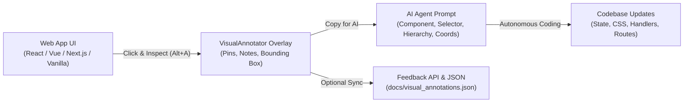

# UI Visual Annotator Skill

The **UI Visual Annotator** is a lightweight, zero-dependency in-app overlay that bridges the gap between visual web UI and autonomous AI coding agents. It enables developers and users to point, click, and annotate any element in a running web application, immediately generating structured prompts that AI agents use to locate and modify code with pinpoint precision.

---

## 1. Core Architecture

The system consists of three modular layers:



1. **In-App Overlay (`VisualAnnotator.tsx` / `visual_annotator_vanilla.js`)**:
   - Floating pill toolbar (bottom-right by default).
   - Global keyboard toggle: **`Alt + A`** toggles annotation mode on/off; **`Esc`** cancels active popovers.
   - **React Fiber Component Introspection**: Automatically resolves the actual React component name (e.g. `<ManagerView>`, `<QuarterlySegmenterModal>`).
   - **DOM Hierarchy Breadcrumbs**: Generates an unambiguous path up to 5 parent levels (e.g. `div.bg-white > div.p-5 > div.flex > h2.text-lg`).
   - **Semantic Context Container**: Discovers the enclosing card/section/header title (e.g. `"Team Rollup Dashboard & Department Oversight"`).
   - **Numbered Coordinate Pins**: Placed at exact click coordinates `(x, y)` with screen resolution.
   - **Category Tagging**: `UI / Style`, `Bug`, `Feature`, `Content`.
   - **Slide-out Notes Drawer**: With one-click **"Copy for AI"** and **"Save to Project"** (`docs/UserInput.md`).
2. **Backend Storage (Optional & Zero-Config Fallback)**:
   - **Browser Fallback**: Pure `localStorage` caching if no backend API is supplied.
   - **Next.js App Router**: [nextjs_route_handlers.ts](./resources/nextjs_route_handlers.ts) (`/api/feedback/annotations`).
   - **FastAPI (Python)**: [feedback_router.py](./resources/feedback_router.py).
3. **AI Feedback Loop**:
   - Emits standardized markdown prompts with pinpoint search anchors for zero-guesswork AI implementation.

---

## 2. Drop-in Integration Options

### Option A: Next.js (App Router / Pages Router) & React

1. **Copy the Component**:
   Copy [VisualAnnotator.tsx](./resources/VisualAnnotator.tsx) into your project:
   - Destination: `src/components/common/VisualAnnotator.tsx` (or `components/VisualAnnotator.tsx`)

2. **Mount in Root Layout (`layout.tsx` / `App.tsx`)**:
   ```tsx
   import { VisualAnnotator } from "@/components/common/VisualAnnotator";

   export default function RootLayout({ children }: { children: React.ReactNode }) {
     return (
       <html lang="en">
         <body>
           {children}

           {/* In-App Visual Annotator Dev Overlay */}
           {process.env.NODE_ENV !== "production" && (
             <VisualAnnotator
               apiEndpoint="/api/feedback" // Optional: syncs to docs/visual_annotations.json
               position="bottom-right"
             />
           )}
         </body>
       </html>
     );
   }
   ```

3. **(Optional) Add Next.js API Routes for Auto-Saving**:
   Copy the Route Handlers from [nextjs_route_handlers.ts](./resources/nextjs_route_handlers.ts) into:
   - `src/app/api/feedback/annotations/route.ts`
   - `src/app/api/feedback/annotations/[id]/route.ts`

---

### Option B: Vanilla JS / HTML / Any Framework (Zero-Build)

1. **Include the Script**:
   Copy [visual_annotator_vanilla.js](./resources/visual_annotator_vanilla.js) into your public folder or inject it directly into `index.html`:
   ```html
   <script src="/path/to/visual_annotator_vanilla.js"></script>
   ```

2. **Or Run via Browser DevTools Console / Bookmarklet**:
   Paste the full contents of `visual_annotator_vanilla.js` into your browser console (`F12 -> Console`) on **any live website** to instantly activate visual annotation without editing code!

---

### Option C: Python FastAPI Backend

1. **Copy the Router**:
   Copy [feedback_router.py](./resources/feedback_router.py) to `backend/api/feedback_router.py`.
2. **Mount in FastAPI App (`main.py`)**:
   ```python
   from backend.api.feedback_router import router as feedback_router

   app.include_router(feedback_router)
   ```

---

## 3. How to Use the Annotator

1. **Activate Annotation Mode**:
   - Press **`Alt + A`** on the keyboard, OR click the floating **"Annotate UI"** pill button.
2. **Inspect & Pin**:
   - Hover over any element to view the dashed bounding box and component tag label.
   - Click directly on the target element.
3. **Enter Note**:
   - Select a category: `UI / Style`, `Bug`, `Feature`, or `Content`.
   - Type your requested change (e.g. *"In this table while approving, manager may need to see the tasks and feedback of that week. Also require WeekNo as column in this table."*).
   - Click **Save Pin**.
4. **Export for AI**:
   - Click **Notes** to open the drawer.
   - Click **"Copy for AI"**.
   - Paste the copied markdown directly into the Antigravity chat prompt!

---

## 4. Handling Visual Annotation Prompts (Agent Guidelines)

When a user submits a prompt starting with `# Requested UI Changes & Visual Annotations`:

1. **Locate Target Files**:
   - **First**: Check `- **Component**: ...` (e.g. `ManagerView` -> `manager-view.tsx`).
   - **Second**: Grep the codebase for `- **Target Text**: ...` (literal search anchor).
   - **Third**: Cross-reference `- **Page**: ...` (route) and `- **DOM Hierarchy**: ...` to confirm the exact JSX node.
2. **Apply Surgical Edits**:
   - Implement the requested styling, state changes, or feature workflows.
3. **Verify & Build**:
   - Run compilation (`npx tsc --noEmit` or `npm run build`) and test verification.
4. **Confirm Resolution**:
   - Report the exact files and lines modified for each annotation ID.

For complete field specifications, refer to [AI Prompt Schema Reference](./references/ai_prompt_format.md).

---

## 5. Transferring This Skill to Another PC

To use this skill on another computer (Windows, macOS, or Linux):

### Step 1: Bundle on Current PC
Run this command in PowerShell on Windows:
```powershell
Compress-Archive -Path "$env:USERPROFILE\.gemini\config\skills\ui-visual-annotator" -DestinationPath "$HOME\Desktop\ui-visual-annotator.zip" -Force
```
*(Or on macOS/Linux: `cd ~/.gemini/config/skills && zip -r ~/Desktop/ui-visual-annotator.zip ui-visual-annotator`)*

### Step 2: Copy to Target PC
Transfer `ui-visual-annotator.zip` via USB drive, cloud storage, email, or git.

### Step 3: Install on Target PC
#### Windows (PowerShell):
```powershell
New-Item -ItemType Directory -Path "$env:USERPROFILE\.gemini\config\skills" -Force
Expand-Archive -Path "C:\path\to\ui-visual-annotator.zip" -DestinationPath "$env:USERPROFILE\.gemini\config\skills" -Force
```

#### macOS / Linux (Terminal):
```bash
mkdir -p ~/.gemini/config/skills
unzip /path/to/ui-visual-annotator.zip -d ~/.gemini/config/skills/
```

### Step 4: Verify Installation
Open Antigravity or Gemini CLI on the new PC. The skill is automatically loaded from `~/.gemini/config/skills/ui-visual-annotator/` and ready for use!

For detailed instructions, refer to [Multi-PC Transfer Guide](./references/TRANSFER_GUIDE.md).
