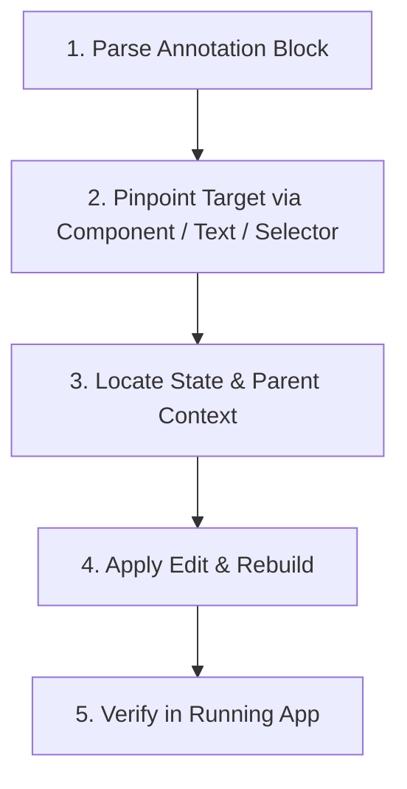

# Visual Annotations Prompt Schema & AI Implementation Protocol

This reference document outlines the standardized markdown prompt schema emitted by the **UI Visual Annotator** and the step-by-step protocol AI agents follow when implementing visual changes.

---

## 1. Standard Prompt Schema

When the user copies annotations from the Visual Annotator drawer or syncs them to project docs (`docs/UserInput.md`), the prompt takes the following structured markdown format:

```markdown
# Requested UI Changes & Visual Annotations

Please implement the following visual feedback changes into the project code:

### Annotation #1: [Feature] ManagerView
- **Selector**: `h2.text-lg.font-black.text-slate-900`
- **DOM Hierarchy**: `div.bg-white > div.p-5 > div > div.flex > h2.text-lg`
- **Context Container**: "Team Rollup Dashboard & Department Oversight"
- **Target Text**: "Manager Governance Command Center"
- **Coordinates**: x=426, y=217 (Screen: 1699x794)
- **Page**: `/manager/dashboard`
- **Requested Change**: In this table while approving, manager may need to see the tasks and feedback of that week. Also require WeekNo as column in this table.

### Annotation #2: [UI / Style] span.font-bold
- **Selector**: `span.font-bold.text-emerald-700`
- **DOM Hierarchy**: `div.grid > div.card > div.flex > span.font-bold`
- **Context Container**: "Q3 Deliverables & SLA Compliance"
- **Target Text**: "95% Score"
- **Coordinates**: x=575, y=635 (Screen: 1699x794)
- **Page**: `/employee/quarterly`
- **Requested Change**: Clarify what this percentage shows with a descriptive tooltip or subtitle.
```

---

## 2. Field Definitions

| Field | Meaning | How AI Agent Uses It |
| :--- | :--- | :--- |
| `[Category]` | `UI / Style`, `Bug`, `Feature`, `Content` | Classifies the nature of the task and scope of code changes. |
| `Component` | React Fiber Component Name (e.g. `ManagerView`, `QuarterlySegmenterModal`) or tag identifier | **Primary File Search Anchor**: Immediately locate the component file (e.g. `manager-view.tsx`). |
| `Selector` | CSS selector path (`tag#id.class1.class2`) | Locate the exact element within the component's JSX/HTML template. |
| `DOM Hierarchy` | Breadcrumb path up to 5 parent levels (`div.bg-white > div.p-5 > h2`) | Unambiguously resolves target element when multiple similar elements share classes. |
| `Context Container` | Title of enclosing card, section, header, or table | Understands business context (e.g. "Team Rollup Dashboard") without guessing. |
| `Target Text` | Exact text rendered inside clicked element | **Literal Search Anchor**: Grep the codebase for this string to locate lines. |
| `Coordinates` | Screen `(x, y)` & resolution | Resolves layout position (top-bar, sidebar, table row, footer) when text is ambiguous. |
| `Page` | Route/URL (`/manager/dashboard`, `/employee/quarterly`) | Identifies which route, page component, or view holds the target element. |
| `Requested Change` | Natural language instruction | The exact specification of what behavior, styling, or logic to change. |

---

## 3. Autonomous AI Implementation Protocol

When an AI agent receives this prompt, it MUST execute the following 5-stage protocol:



### Stage 1: Parse & Prioritize
1. Extract all annotations sequentially (Annotation #1, #2, etc.).
2. Group related annotations affecting the same component or file to avoid conflicting edits.

### Stage 2: Codebase Localization (Target Search)
1. **First-line search**: If `Component` specifies a React Component name (e.g. `ManagerView`), look for that file directly (`src/components/**/manager-view.tsx`).
2. **Second-line search**: Grep the codebase for the literal `Target Text` (or distinctive words in it).
   - E.g., for `"Manager Governance Command Center"`, grep for `"Manager Governance"`.
3. **Third-line search**: Trace the route defined in `Page` (e.g. `/manager/dashboard` -> `src/app/manager/dashboard/page.tsx`).
4. **Disambiguation**: Use `DOM Hierarchy` and `Context Container` to verify you are editing the exact JSX node intended.

### Stage 3: Root Cause & State Analysis
1. Read the matching file and identify where the component is rendered.
2. Determine if the requested change is:
   - **Styling / CSS**: Adjust colors, margins, padding, layout, flexbox, grid, font size.
   - **Data / Column Addition**: Add new table columns, telemetry badges, or filters.
   - **Default State**: Modify initial state (e.g. `useState(true)` vs `useState(false)`).
   - **Event Handler / Modal**: Add action buttons, inline accordions, or pop-up modals.
   - **Conditional Rendering**: Add/remove conditions or fallback values.

### Stage 4: Code Edit & Rebuild
1. Use `edit_file` to make surgical, clean modifications adhering to project coding guidelines.
2. Run project build or test commands (e.g. `npm run build`, `npm test`, or backend reload) to verify there are zero TypeScript, lint, or runtime errors.

### Stage 5: Verification & Confirmation
1. Verify the service is running and serving the updated assets.
2. Confirm each annotation ID is addressed with a concise summary of the file changed and behavior updated.
